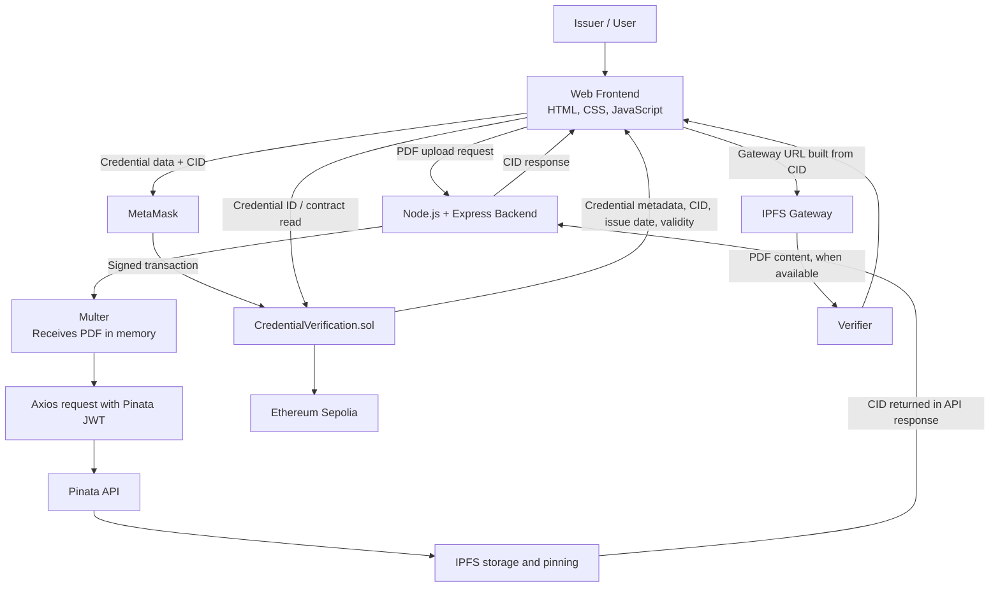

# Blockchain-Based Credential Verification System Using IPFS

A web-based academic credential issuance and verification prototype that combines **Ethereum smart contracts** with **IPFS document storage**. PDF certificates are uploaded through a Node.js/Express backend to Pinata, which pins the content on IPFS and returns a Content Identifier (CID). The application associates that CID with credential metadata recorded by a Solidity smart contract on the Ethereum Sepolia test network.

> **Project status:** Academic prototype. The project has been tested using a local frontend/backend setup, Pinata/IPFS uploads, MetaMask and the Sepolia test network. It is not presented as a production-ready university credential platform.

---

## Table of contents

1. [Project overview](#1-project-overview)
2. [Main features](#2-main-features)
3. [System architecture](#3-system-architecture)
4. [Technology stack](#4-technology-stack)
5. [Project structure](#5-project-structure)
6. [Prerequisites](#6-prerequisites)
7. [Configuration and environment variables](#7-configuration-and-environment-variables)
8. [Installation](#8-installation)
9. [Compile and deploy the smart contract](#9-compile-and-deploy-the-smart-contract)
10. [Configure the frontend contract connection](#10-configure-the-frontend-contract-connection)
11. [Run the application](#11-run-the-application)
12. [How the application works](#12-how-the-application-works)
13. [Smart contract overview](#13-smart-contract-overview)
14. [IPFS, Pinata and CID explained](#14-ipfs-pinata-and-cid-explained)
15. [Testing checklist](#15-testing-checklist)
16. [Troubleshooting](#16-troubleshooting)
17. [Security notes](#17-security-notes)
18. [Known limitations and future improvements](#18-known-limitations-and-future-improvements)
19. [Project team](#19-project-team)

---

## 1. Project overview

Traditional academic credential verification can involve manual document checks and contacting the institution that issued a certificate. A verifier may also have difficulty determining whether a digital document is the same document that was originally issued.

This project demonstrates an alternative workflow using blockchain records and content-addressed file storage:

- The **PDF certificate** is uploaded to IPFS through Pinata.
- Pinata returns the file's **CID (Content Identifier)**.
- The **credential metadata and CID** are submitted to a Solidity smart contract.
- The smart contract records the credential on the **Ethereum Sepolia test network**.
- A verifier enters the credential ID to retrieve the associated record.
- The CID can be used to retrieve the certificate through an IPFS gateway.

The PDF itself is **not stored directly on Ethereum**. The blockchain stores the credential information and the CID that points to the IPFS content.

## 2. Main features

- Connect a browser wallet using MetaMask.
- Enter a credential ID, student name, course/credential name and institution.
- Select a PDF certificate for upload.
- Send the PDF to the Node.js/Express backend.
- Upload and pin the PDF through the Pinata API.
- Receive the IPFS CID from Pinata's API response.
- Associate the CID with the credential record on the blockchain.
- Verify a credential using its credential ID.
- Retrieve the stored CID and use it to open the related PDF through an IPFS gateway.
- The Solidity contract also includes a credential-revocation function. A frontend revocation control should only be documented as available if it is present in the version of the frontend being used.

## 3. System architecture

### 3.1 High-level architecture



### 3.2 Two separate data paths

**Document storage path**

`PDF → Frontend → Express Backend → Multer → Axios → Pinata → IPFS → CID`

**Credential registration path**

`Credential metadata + CID → Frontend / Ethers.js → MetaMask → Smart Contract → Sepolia`

This separation avoids storing the complete PDF on-chain. The contract stores the reference (CID) and the credential information required by the application.

### 3.3 Credential verification path

`Verifier enters credential ID → Frontend calls verifyCredential() → Smart Contract returns stored details → Frontend displays the result → CID is used to access the certificate through an IPFS gateway.`

A blockchain record and a CID help with traceability and content identification. They do not, by themselves, prove that the issuing institution is genuine or that the original issuer was authorised. Issuer authentication and institutional governance would be needed for a real deployment.

## 4. Technology stack

| Technology | Role in this project |
|---|---|
| HTML | Structure of the web pages and forms |
| CSS | Layout and visual styling |
| JavaScript | Frontend logic and user interactions |
| Node.js | Runtime for the backend server |
| Express.js | HTTP server and upload route |
| Multer | Receives multipart PDF uploads; configured to use memory storage in the supplied backend implementation |
| FormData | Packages the file and metadata for the Pinata request |
| Axios | Sends the HTTP upload request to Pinata |
| Pinata | Provides an API for uploading and pinning content on IPFS |
| IPFS | Content-addressed storage and retrieval of the certificate file |
| Solidity 0.8.28 | Smart contract language |
| Hardhat | Contract compilation and deployment tooling |
| Ethereum Sepolia | Blockchain test network |
| MetaMask | Browser wallet and transaction approval |
| Ethers.js v6 | JavaScript library used by the browser code to interact with the contract |

## 5. Project structure

The following is the expected logical structure based on the project files used during development. Generated folders such as `node_modules`, `artifacts` and `cache` may appear after installation and compilation.

```text
Blockchain-Credential-Verification/
│
├── contracts/
│   └── CredentialVerification.sol
│
├── scripts/
│   └── deploy.js
│
├── artifacts/                 # Generated by Hardhat after compilation
├── cache/                     # Generated by Hardhat
│
├── backend/
│   ├── server.js
│   ├── package.json
│   ├── package-lock.json
│   └── .env                    # Local secrets; do not commit
│
├── index.html
├── style.css
├── script.js
├── hardhat.config.js
├── package.json
├── package-lock.json
├── .gitignore
└── README.md
```

If your local folder names differ, follow the actual folder names in your copy of the project.

## 6. Prerequisites

Install or prepare the following before running the project:

1. **Node.js and npm** – required for the Hardhat project and backend.
2. **Visual Studio Code** or another code editor.
3. **MetaMask browser extension** – unlocked and configured for Sepolia.
4. **Sepolia test ETH** – required by the deploying/issuing wallet to pay test-network gas fees. Sepolia ETH is test currency, not real ETH.
5. **A Pinata account and API key/JWT** with the permissions needed by the upload endpoint.
6. **A browser** with the MetaMask extension installed.
7. **VS Code Live Server** (or another static HTTP server) for serving `index.html` locally.

Check that Node.js and npm are available from a terminal:

```bash
node -v
npm -v
```

## 7. Configuration and environment variables

The project uses two separate environment files. They serve different purposes and must not be confused.

### 7.1 Root `.env` — Hardhat / blockchain deployment

Create or update the `.env` file in the project root:

```env
SEPOLIA_RPC_URL=YOUR_SEPOLIA_RPC_ENDPOINT
PRIVATE_KEY=YOUR_DEPLOYER_WALLET_PRIVATE_KEY
```

- `SEPOLIA_RPC_URL` is the RPC endpoint used by Hardhat to connect to Sepolia.
- `PRIVATE_KEY` is the private key of the account used by the deployment configuration.

**Never paste the real values into this README, frontend code, screenshots, public repositories or reports.** Do not share the private key with anyone.

### 7.2 `backend/.env` — Pinata authentication

Create or update the `.env` file inside the `backend` folder:

```env
PINATA_JWT=YOUR_PINATA_JWT
```

Use the JWT generated for the Pinata API key. The key must have the necessary write/upload permissions for the API endpoint used by the backend.

- Do not put the Pinata JWT in the root Hardhat `.env` unless your code is explicitly configured to read it there.
- Do not put the Pinata JWT in `script.js` or `index.html`.
- Do not commit either `.env` file to GitHub.

### 7.3 Suggested `.gitignore` entries

Check that the root `.gitignore` excludes secrets and generated dependencies. For example:

```gitignore
node_modules/
backend/node_modules/
.env
.env.*
!.env.example
backend/.env
artifacts/
cache/
coverage/
.DS_Store
```

If you intentionally need to share a sample configuration, create `.env.example` with placeholder values only. Never copy actual credentials into it.

## 8. Installation

Open the project folder in VS Code.

### 8.1 Install root dependencies

Open a terminal at the project root (the folder containing `hardhat.config.js` and the root `package.json`) and run:

```bash
npm install
```

### 8.2 Install backend dependencies

Open a second terminal or change directory into the backend folder:

```bash
cd backend
npm install
```

The backend uses a separate `package.json`, so its dependencies must be installed from inside `backend`.

## 9. Compile and deploy the smart contract

> Deploy only when setting up a new deployment or when you intentionally need a new contract address. You do not need to redeploy every time you open the project. A deployment creates a new contract address; the frontend must then be configured to use that address.

### 9.1 Compile

From the project root:

```bash
npx hardhat compile
```

Hardhat should compile `contracts/CredentialVerification.sol` using Solidity version `0.8.28`.

### 9.2 Deploy to Sepolia

Ensure the root `.env` has a working RPC endpoint and deployer private key. Ensure the deployer account has Sepolia test ETH. Then run:

```bash
npx hardhat run scripts/deploy.js --network sepolia
```

The deployment script should print the deployed contract address. Save the address. The contract owner is the account that deployed the contract.

### 9.3 Existing deployment address

The project development history recorded this Sepolia contract address:

```text
0x81C0eB6E7694C521E70d258d2b913B725F17F1F2
```

**Verify that this is still the address used by your current `script.js` and that the contract is still accessible on Sepolia before relying on it.** If the contract was redeployed, use the new address instead.

Sepolia's chain ID is `11155111` (hexadecimal `0xaa36a7`). MetaMask must be connected to Sepolia when using this deployment.

## 10. Configure the frontend contract connection

Open `script.js` and check these items:

1. `CONTRACT_ADDRESS` must contain the address of the deployed `CredentialVerification` contract.
2. `CONTRACT_ABI` must match the ABI of that exact deployed contract.
3. The frontend must use the correct function signatures and argument order.
4. The page must load Ethers.js v6 before loading `script.js`.

The issuance function in the supplied Solidity implementation accepts five string values in this order:

```text
credentialId, studentName, courseName, institution, ipfsCid
```

The verification function accepts the credential ID. In the supplied contract implementation, its returned values are:

```text
studentName, courseName, institution, ipfsCid, issueDate, isValid
```

Use the ABI generated by Hardhat at:

```text
artifacts/contracts/CredentialVerification.sol/CredentialVerification.json
```

The frontend ABI should be kept in sync with the deployed Solidity contract. An ABI mismatch can produce errors such as “no matching fragment” or `UNSUPPORTED_OPERATION`.

**Ethers.js:** Load one Ethers.js version only. Do not include two different Ethers CDN script tags in `index.html`, because duplicate library loads can cause confusing behaviour.

Example ordering (use a single Ethers v6 CDN reference):

```html
<script src="https://cdn.jsdelivr.net/npm/ethers@6.13.5/dist/ethers.umd.min.js"></script>
<script src="script.js"></script>
```

If the version in your final project differs, keep the version that matches the code you tested.

## 11. Run the application

The frontend and backend are separate processes. **Both must be running** for certificate upload and the full issue workflow.

### 11.1 Start the backend

Open a terminal in VS Code:

```bash
cd backend
node server.js
```

Expected startup message:

```text
Backend running at http://localhost:3000
```

You can check the backend test route by opening:

```text
http://localhost:3000/
```

Expected response:

```text
Backend server is running!
```

Keep this terminal open while using the application.

### 11.2 Start the frontend

In VS Code:

1. Open `index.html`.
2. Right-click inside the editor.
3. Select **Open with Live Server**.
4. The browser should open an address similar to:

```text
http://127.0.0.1:5500/index.html
```

Keep the backend terminal running. If Live Server chooses a different port, use the actual URL shown by the browser.

### 11.3 Connect MetaMask

1. Unlock MetaMask.
2. Select the account that deployed the smart contract when issuing or revoking credentials.
3. Switch the network to **Sepolia**.
4. Open the project website.
5. Click **Connect MetaMask** and approve the connection request.

The smart contract uses an owner restriction for issuance and revocation. If the connected account is not the contract owner, an owner-only operation will revert. A wallet connection by itself does not make an account the contract owner.

## 12. How the application works

### 12.1 Issuing a credential

1. Open the application using Live Server.
2. Connect MetaMask to Sepolia.
3. Enter a new, unique credential ID.
4. Enter the student's name.
5. Enter the course or credential name.
6. Enter the institution name.
7. Select the certificate PDF.
8. Click **Issue Credential**.
9. The frontend sends the PDF to the backend upload endpoint.
10. The backend validates the uploaded file and sends it to Pinata.
11. Pinata uploads and pins the content on IPFS and returns the CID.
12. The backend returns the CID to the frontend.
13. The frontend calls the smart contract's `issueCredential()` function with the credential metadata and CID.
14. MetaMask displays the transaction for approval.
15. Approve the transaction and wait for blockchain confirmation.
16. The application should display a successful issuance message after confirmation.

Use a **new credential ID** for each new issuance. The contract prevents a credential ID from being issued more than once.

### 12.2 Verifying a credential

1. Open the verification section.
2. Enter the credential ID.
3. Click **Verify Credential**.
4. The frontend calls `verifyCredential()` on the deployed contract.
5. The contract returns the stored student name, course name, institution, CID, issue timestamp and validity flag.
6. The frontend displays the returned information.
7. The CID can be used to construct an IPFS gateway URL for opening the PDF.

The issue date is stored as a Unix timestamp (`block.timestamp`). The frontend can convert it to a readable date by converting seconds to milliseconds before constructing a JavaScript `Date`.

### 12.3 Retrieving the certificate

A gateway URL has the following general format:

```text
https://gateway.pinata.cloud/ipfs/<CID>
```

Replace `<CID>` with the CID returned by the contract. Retrieval depends on the content being available through the selected gateway and the Pinata/IPFS pinning service.

### 12.4 Revoking a credential

The Solidity contract includes `revokeCredential(credentialId)`, which changes the credential's `isValid` field to `false`. It does not delete the blockchain record or remove the PDF from IPFS.

Revocation is an owner-restricted blockchain transaction. Only describe the revocation workflow as available from the website if the current frontend contains a working revocation control. Otherwise, it can be called through an appropriate contract interaction tool or implemented as a future frontend enhancement.

## 13. Smart contract overview

The contract is named `CredentialVerification` and is written in Solidity `0.8.28`.

### 13.1 Credential record

The contract's credential structure contains:

| Field | Description |
|---|---|
| `studentName` | Name of the credential holder |
| `courseName` | Course or credential name |
| `institution` | Institution recorded as issuing the credential |
| `credentialId` | Unique identifier supplied for the credential |
| `ipfsCid` | CID of the certificate file stored on IPFS |
| `issueDate` | Blockchain timestamp at issuance |
| `isValid` | Boolean validity status; set to `true` on issuance and set to `false` on revocation |

### 13.2 Owner restriction

The contract records `msg.sender` as `owner` in its constructor. The `onlyOwner` modifier checks that the caller matches this owner before allowing protected operations.

### 13.3 Main functions

| Function | Purpose | Interaction type |
|---|---|---|
| `issueCredential(...)` | Creates a credential record and stores the supplied metadata and CID; rejects duplicate credential IDs | State-changing transaction |
| `verifyCredential(credentialId)` | Retrieves the record and returns its details and validity flag; reverts when the credential does not exist | Read-only call |
| `revokeCredential(credentialId)` | Changes an existing credential's validity flag to `false` | State-changing, owner-restricted transaction |

The contract also defines `CredentialIssued` and `CredentialRevoked` events. Refer to the actual Solidity source and compiled ABI for the exact event signatures and function definitions.

## 14. IPFS, Pinata and CID explained

### What is IPFS?

The InterPlanetary File System (IPFS) is a peer-to-peer protocol for addressing and retrieving content. It uses content addressing rather than relying only on a file's location on one server.

### What is Pinata?

Pinata is a service that provides an API for uploading and pinning content on IPFS. In this project, the backend sends the PDF to Pinata. Pinata handles the upload/pinning workflow and returns the CID in its API response.

### What is a CID?

A Content Identifier is a content-based identifier for data stored using IPFS. IPFS constructs a content-addressed representation of the file; for larger files, that representation may contain multiple blocks organised into a DAG. The root CID identifies that content structure.

The CID is not a manually assigned certificate number and is not simply a conventional URL. It is also not necessarily a direct SHA-256 hash of the entire original PDF. The CID includes information about the content-addressing representation, including codec and multihash information.

### How the backend obtains the CID

The backend posts the file to Pinata's upload API. In the backend implementation, the response is read using:

```javascript
const cid = response.data.IpfsHash;
```

The backend then returns the CID to the frontend. The application supplies it to the smart contract as the `ipfsCid` value.

### Why store the CID on the blockchain?

The CID links the on-chain credential record to the off-chain certificate. This avoids storing the full PDF in contract storage while retaining a content-addressed reference that can be used to retrieve the file.

If a file's content changes, its content-addressed representation will normally produce a different CID. This supports content-integrity checking, but it does not independently prove who created or issued the document.

## 15. Testing checklist

Record the actual result observed when performing each test. Do not mark a test as passed unless it has been executed.

| ID | Test | Expected outcome | Actual result |
|---|---|---|---|
| T01 | Start backend with `node server.js` | Backend listens on port 3000 | To be recorded |
| T02 | Open backend root route | “Backend server is running!” response | To be recorded |
| T03 | Upload a valid PDF | Backend receives file and Pinata returns a CID | To be recorded |
| T04 | Submit without selecting a file | Backend/frontend reports missing file | To be recorded |
| T05 | Submit a non-PDF file | File is rejected by validation | To be recorded |
| T06 | Upload with invalid/missing Pinata permissions | Upload fails with an API error; no credential should be issued | To be recorded |
| T07 | Connect MetaMask to Sepolia | Wallet connection succeeds | To be recorded |
| T08 | Issue a new credential as contract owner | Transaction confirms and record is stored | To be recorded |
| T09 | Issue a duplicate credential ID | Contract rejects duplicate ID | To be recorded |
| T10 | Verify an existing credential ID | Stored credential information is returned | To be recorded |
| T11 | Verify an unknown credential ID | Contract reports that the credential does not exist | To be recorded |
| T12 | Open the certificate using its CID | Gateway retrieves the pinned PDF when available | To be recorded |
| T13 | Attempt owner-only action from a different account | Contract rejects the operation | To be recorded |
| T14 | Revoke an existing credential, if tested | `isValid` becomes `false` | To be recorded |

## 16. Troubleshooting

### 16.1 `NO_SCOPES_FOUND` from Pinata

**Likely cause:** The API key/JWT being used does not have the required permissions for the upload endpoint.

**Checks:**
- Confirm the `PINATA_JWT` value in `backend/.env` is the intended current JWT.
- Confirm the Pinata API key has the required file upload/write permissions for the endpoint used by the backend.
- Ensure the JWT is copied completely and has no quotation marks or accidental spaces.
- Restart the backend after changing `.env` so the process loads the new value.

### 16.2 `Failed to fetch` or `POST http://localhost:3000/upload-certificate` fails

**Checks:**
- Confirm the backend terminal still shows `Backend running at http://localhost:3000`.
- Confirm the frontend sends requests to the same backend URL and port.
- Confirm the request uses the expected multipart field name `certificate`.
- Inspect the backend terminal for the actual error returned by Pinata or Express.

A browser message that the backend server is running only confirms that the root route responds. It does not prove that the file upload endpoint or Pinata authentication is working.

### 16.3 `no matching fragment` / `UNSUPPORTED_OPERATION`

**Likely cause:** The frontend ABI or function arguments do not match the deployed contract.

**Checks:**
- Confirm the contract address is correct for the selected network.
- Confirm the ABI is from the same contract version that was deployed.
- Confirm `issueCredential()` receives five arguments in the correct order, including the IPFS CID.
- Confirm `verifyCredential()` receives the credential ID.

### 16.4 Transaction reverts with an owner-related message

**Likely cause:** The connected MetaMask account is not the account that deployed the contract.

**Fix:** Switch MetaMask to the deploying account and ensure Sepolia is selected.

### 16.5 Transaction reverts because the credential already exists

**Cause:** The contract does not allow duplicate credential IDs.

**Fix:** Use a new unique credential ID for a new issuance. Do not try to issue the same ID again.

### 16.6 `missing revert data` or `CALL_EXCEPTION`

Possible causes include a wrong contract address, wrong network, ABI mismatch, a failed `require` condition or a call made with the wrong account. Check the contract address, chain, function parameters and full browser console message before changing code.

### 16.7 `Identifier has already been declared` involving Ethers.js

Check `index.html` and ensure that only one Ethers.js CDN script is included. Load it before `script.js`.

### 16.8 Root `.env` and backend `.env` are mixed up

The root `.env` is used by Hardhat for blockchain deployment configuration. `backend/.env` is used by the backend for `PINATA_JWT`. Update the correct file and restart the relevant process.

### 16.9 `EJSONPARSE` from npm

This indicates that npm cannot parse the `package.json` file in the current directory. Check that the file is valid JSON and is not empty. Also confirm that `npm install` is being run from the directory containing the intended `package.json`.

## 17. Security notes

- Never publish the root `.env` or `backend/.env`.
- Never place a wallet private key or Pinata JWT in frontend JavaScript or HTML.
- Keep the Pinata JWT on the backend only.
- Use a dedicated test wallet for Sepolia development.
- Do not use real student personal information during public demonstrations unless authorised.
- Data stored on a public blockchain can be visible to network participants and may be difficult or impossible to remove.
- Restrict issuer operations and review the smart contract before any real deployment.
- The current `onlyOwner` design is a basic access-control mechanism, not a full institutional identity or role-management system.
- Use HTTPS and suitable server-side validation before exposing the backend publicly.
- Consider file size limits, MIME-type checks and stronger file-content validation before production use. A MIME type alone is not sufficient to establish that a file is safe.

## 18. Known limitations and future improvements

### Current limitations

- The application is a prototype intended for academic demonstration.
- The contract is deployed on Sepolia, a test network, rather than being a production credential registry.
- Issuance and revocation are restricted to the contract owner account.
- The system does not independently authenticate an institution or prove that a submitted certificate is genuinely authorised by that institution.
- The Pinata service and configured IPFS gateway are dependencies of the current document upload/retrieval workflow.
- Public blockchain metadata can create privacy concerns if personal information is stored on-chain.
- A working revocation function in the contract does not necessarily mean a revocation button exists in the frontend.
- The prototype has not been represented as having undergone a professional smart-contract security audit.

### Possible future improvements

- Add institutional accounts and stronger issuer authentication.
- Introduce role-based access and multiple authorised issuers.
- Add QR-code-based verification links.
- Add a complete administrator interface for issuing and revoking credentials.
- Reduce personal information stored directly on-chain.
- Add document validation, file size limits and upload abuse protection.
- Improve transaction history and audit views.
- Add automated smart-contract and integration tests.
- Conduct a professional security review before production use.
- Evaluate alternative pinning providers and gateway availability.
- Integrate with university student-information systems after appropriate authorisation.

## 19. Project team

| Name | PRN |
|---|---|
| Ayush Raut | 23070521028 |
| Harsh Motghare | 23070521057 |
| Ved Bisne | 23070521035 |

**Project guide:** Dr. Shyamal Laddha

**Institution:** Symbiosis Institute of Technology, Nagpur Campus  
**Department:** Computer Science and Engineering  
**Academic year:** 2025–2026

---

## Quick start summary

For a normal project demonstration after the initial setup and deployment have already been completed:

**Terminal 1 — Backend**

```bash
cd backend
node server.js
```

**Terminal 2 — Frontend**

Open `index.html` with VS Code Live Server.

**Browser and wallet**

1. Open the Live Server URL.
2. Unlock MetaMask and select the contract owner's account.
3. Switch to Sepolia.
4. Connect the wallet.
5. Upload a PDF and issue a new credential ID, or verify an existing credential ID.

You normally do not need to redeploy the smart contract every time you run the application. Redeploy only when you intentionally deploy a new contract version, and then update the frontend contract address and ABI.
